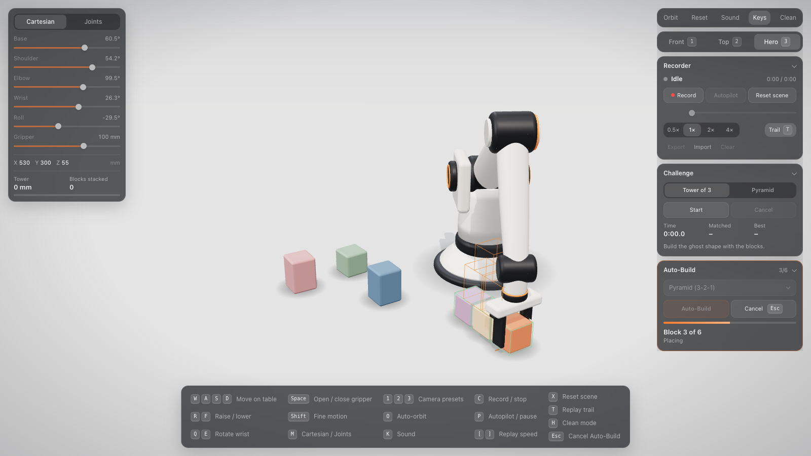
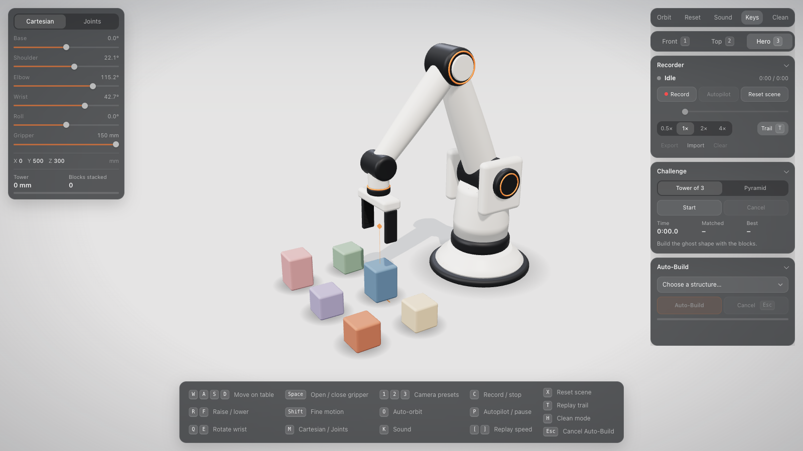
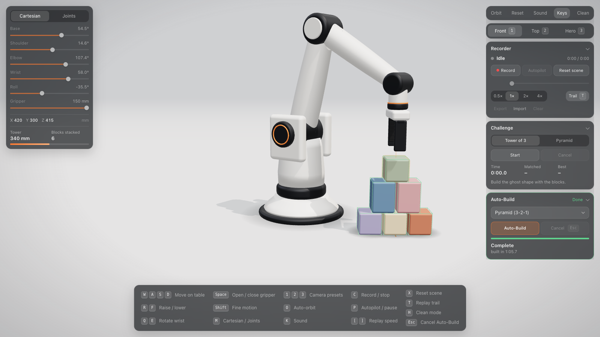
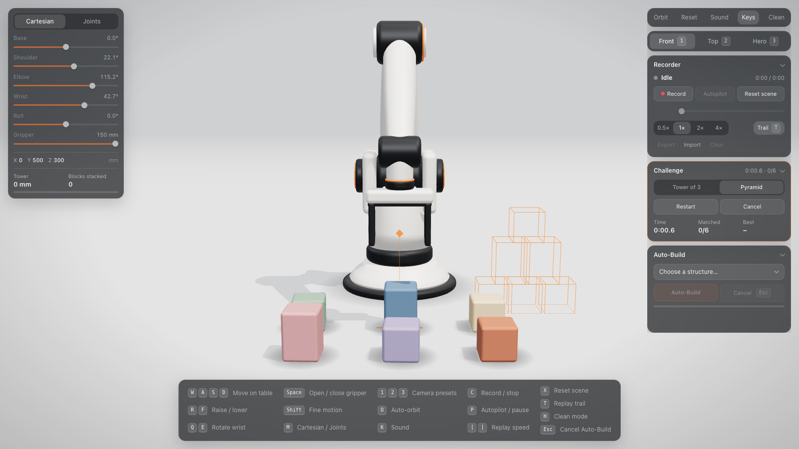
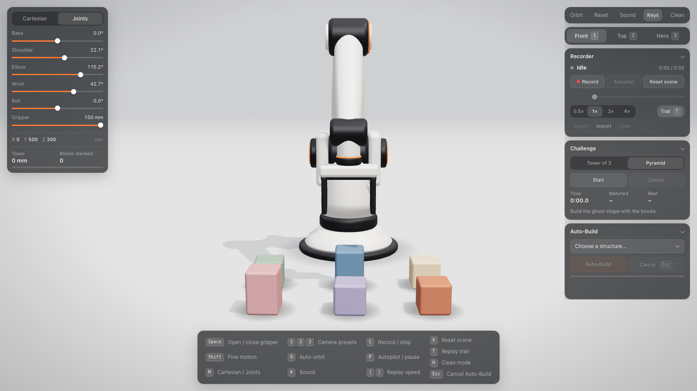
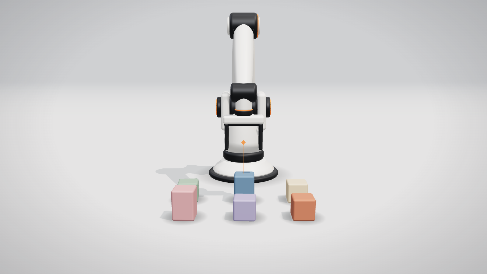
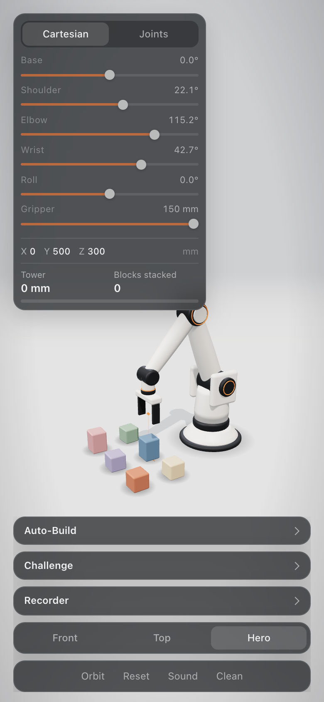
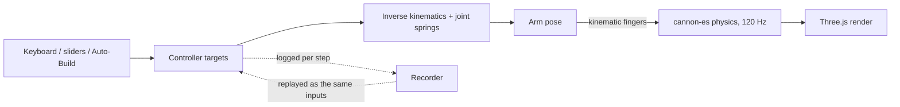

<div align="center">

# Robot Arm Simulator

**An industrial-style robot arm in your browser: inverse kinematics, rigid-body physics, exact record/replay, and an auto-builder that stacks blocks by itself.**

[](https://github.com/aluinn/robot-arm/actions/workflows/ci.yml)
[](https://github.com/aluinn/robot-arm/actions/workflows/codeql.yml)
[](LICENSE)
[](https://github.com/aluinn/robot-arm/stargazers)
[](#deploy)

<!--
  HERO PLACEHOLDER: replace the image below with a short screen recording (GIF or MP4) of Auto-Build
  stacking the pyramid, e.g. docs/assets/demo.gif, then update the  src.
-->


[Live demo](https://aluinn.github.io/robot-arm/) · [Architecture](docs/ARCHITECTURE.md) · [Roadmap](ROADMAP.md) · [Contributing](CONTRIBUTING.md)

</div>

## Features

- **Five-joint arm with a parallel gripper**, driven from the keyboard in Cartesian mode (move the gripper target) or Joints mode (sliders per joint).
- **Closed-form inverse kinematics** with joint limits, wrist-roll selection that never spins the long way round, and workspace-edge sliding when a target is out of reach.
- **Rigid-body physics** (cannon-es) at a fixed 120 Hz step, tuned so blocks stack and stay stacked.
- **Auto-Build**: pick a Tower, Pyramid, Wall or Staircase and the arm plans and builds it from whatever layout the blocks are in, re-grasping and re-placing when a check fails.
- **Record and Autopilot**: record your inputs, replay them, scrub the timeline, change speed (0.5x to 4x). A replay is checked against the recorded end state.
- **Challenges**: Tower of 3 and Pyramid with a translucent ghost target, timer and remembered best times.
- **Export / import** recordings as validated JSON.
- **Camera presets**, optional synthesized sound, clean (UI-free) mode and a touch-friendly layout.
- **No build step**: plain ES modules, Three.js and cannon-es from a pinned CDN import map.

## Screenshots

| | |
| --- | --- |
| <br>Overview | <br>Auto-Build finished (pyramid, front view) |
| <br>Challenge with ghost target | <br>Joints mode |

<details>
<summary>More screenshots</summary>

| | |
| --- | --- |
| <br>Clean mode (`H`) | <br>Phone layout (390 x 844) |

</details>

## How it works



1. **Targets in, joint angles out.** Input (or the Auto-Build planner) moves a target pose. A closed-form solver turns it into joint angles; every joint follows its target with a critically damped spring.
2. **Fixed-step physics.** The simulation only advances in 1/120 s steps, always in the order commands, arm, physics. Frame rate only changes how many steps run per frame.
3. **Grasping is a lock, not friction.** When the pads close on a block it is locked to the gripper frame, which avoids jitter and slipping. Opening hands it back to the solver with the tool's velocity.
4. **Replays re-run the same inputs.** The recorder logs controller outputs only when they change and feeds them back into a freshly built physics world. Nothing is teleported.

More detail: [docs/ARCHITECTURE.md](docs/ARCHITECTURE.md). Controls and feature reference: [docs/USAGE.md](docs/USAGE.md).

## Quick start

Requires Node 20+ for the dev server and tooling (the app itself runs in any modern browser with WebGL).

```sh
git clone https://github.com/aluinn/robot-arm.git
cd robot-arm
npm install        # dev tooling only; the app has no runtime dependencies
npm start          # http://localhost:3000
```

Open the printed URL. You need a network connection on first load, because Three.js and cannon-es come from a CDN.

| Command | What it does |
| --- | --- |
| `npm start` | Static dev server (`scripts/serve.mjs`), port 3000 or `PORT` |
| `npm test` | Unit tests (`node --test`) |
| `npm run test:e2e` | Playwright end-to-end smoke test |
| `npm run lint` | ESLint |
| `npm run typecheck` | TypeScript `checkJs` over `src/` |
| `npm run build` | Copy the static site to `dist/` and verify it |
| `npm run screenshots` | Regenerate `docs/assets/screenshot-*.png` |
| `npm run bench` | Measure simulation step cost, see [PERFORMANCE](docs/PERFORMANCE.md) |

Add `?debug` to the URL to expose `window.__app` (arm, physics, actions) for scripting and tests.

## Deploy

The site is static, so any static host works. The repo includes a GitHub Pages workflow (`.github/workflows/pages.yml`): in **Settings > Pages**, set **Source** to **GitHub Actions**, and every push to `main` publishes to `https://aluinn.github.io/robot-arm/`.

## FAQ

**Does it work offline?** Not out of the box. Three.js and cannon-es load from jsDelivr through an import map. Vendoring them is a [good first issue](docs/issues/09-vendor-dependencies-offline.md).

**Are replays really exact?** Bit-for-bit in the same browser on the same machine. A different JavaScript engine may differ in floating-point details, in which case the end-of-replay check reports the divergence. Recordings carry a simulator version and are rejected if it does not match.

**Which browsers are tested?** Development and the automated screenshots and tests use Chrome. Other WebGL-capable browsers should work but have not been verified.

**Can Auto-Build use any layout?** Almost. Blocks must be upright (a block on its side is not used) and within the arm's reach. See [Auto-Build](docs/USAGE.md#auto-build) for the details.

**Does it run on a phone?** Yes, with a touch layout that starts in Joints mode. On a 390 x 844 screen the slider panel overlaps the top of the arm in the default view, as the phone screenshot shows.

**Is this a model of a specific robot?** No. The dimensions in `src/config.js` are a generic five-joint arm with a parallel gripper, not a real product, and nothing here is calibrated for real hardware.

## Good first issues

Drafts are in [docs/issues](docs/issues); copy one into a GitHub issue to start.

| Issue draft | Label |
| --- | --- |
| [Add a new Auto-Build structure](docs/issues/01-add-autobuild-structure.md) | good first issue |
| [Add more challenge shapes](docs/issues/02-add-challenge-shapes.md) | good first issue |
| [Add page metadata and a social preview](docs/issues/03-page-metadata-social-preview.md) | good first issue |
| [Remember UI preferences](docs/issues/04-persist-ui-preferences.md) | good first issue |
| [Accessible labels for controls](docs/issues/05-accessible-controls.md) | good first issue |
| [Gamepad input](docs/issues/06-gamepad-input.md) | enhancement |
| [Show the reachable workspace as an overlay](docs/issues/07-reach-envelope-overlay.md) | enhancement |
| [Auto-Build with blocks lying on their side](docs/issues/08-autobuild-lying-blocks.md) | enhancement |
| [Vendor dependencies for offline use](docs/issues/09-vendor-dependencies-offline.md) | enhancement |
| [Drag the target on touch screens](docs/issues/10-touch-drag-target.md) | enhancement |

## Roadmap

See [ROADMAP.md](ROADMAP.md).

## Credits

- [Three.js](https://threejs.org/) for rendering (MIT), loaded from [jsDelivr](https://www.jsdelivr.com/).
- [cannon-es](https://github.com/pmndrs/cannon-es) for rigid-body physics (MIT).
- Built by [Aluinn McDonald](https://github.com/aluinn), with help from [Claude Code](https://claude.com/claude-code).

## License

[MIT](LICENSE) © Aluinn McDonald
