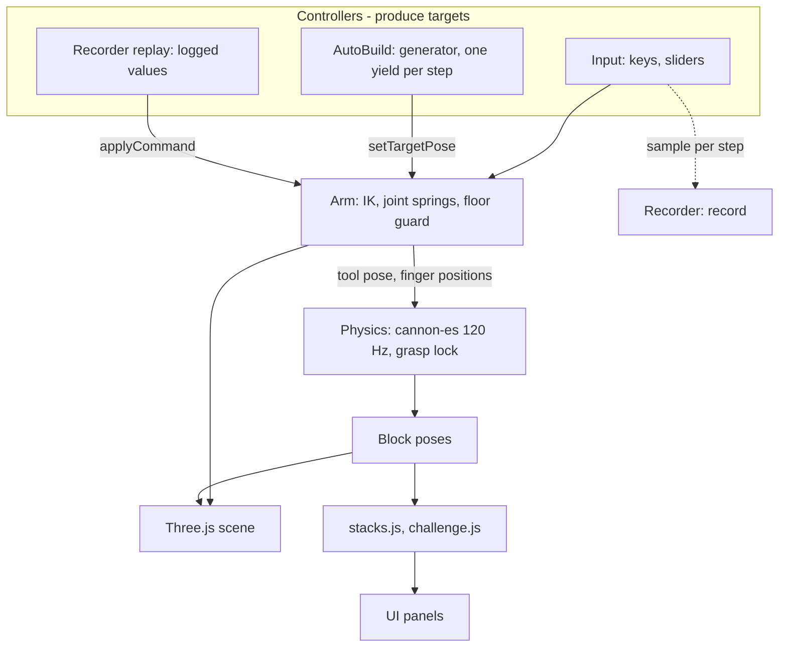
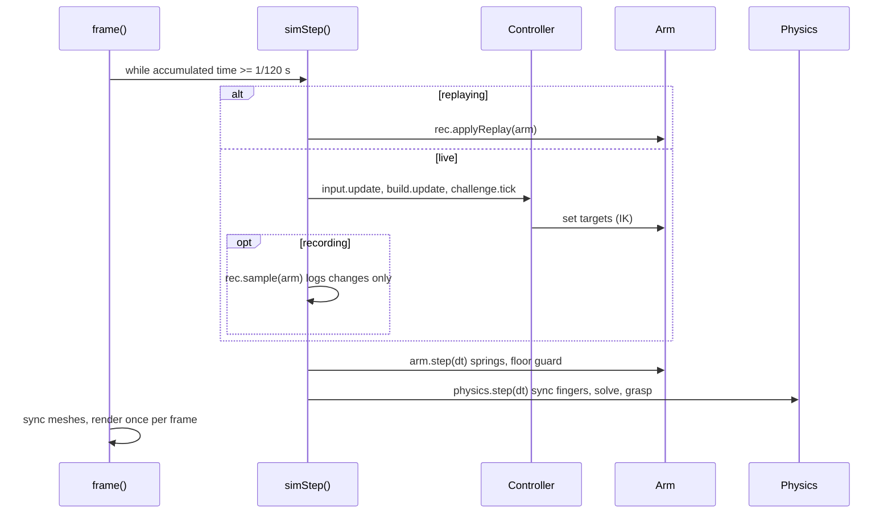

# Architecture

The app is a static page: `index.html` plus ES modules in `src/`. Three.js (rendering) and cannon-es (physics) are the only libraries and are loaded from a pinned CDN import map. There is no bundler.

## Data flow



All three controllers write to the same place, the arm's targets. The arm does not know who is driving it, which is why an Auto-Build can be recorded and replayed with no special support.

## One simulation step



The order is fixed: commands, arm, physics. Frame rate and replay speed only change how many steps run per frame.

## Key decisions and trade-offs

| Decision | Why | Cost |
| --- | --- | --- |
| **Closed-form IK**, not an iterative solver | Exact, no iteration count to tune, cheap, and the same input always gives the same output, which replay needs. | Only fits this arm shape (yaw plus a planar chain); a different arm needs a new solver. |
| **Critically damped springs** per joint | Smooth start and stop with no overshoot, and a speed cap. | Joints lag their targets; the floor guard exists because that lag can briefly cut a corner through the floor. |
| **Grasp is a lock**, not friction | Friction grasps jitter, slip and blow up solvers. A grasped block is made kinematic, eased into the grip and snapped to the nearest of the 24 axis-aligned orientations. | Not physically honest: a block never slips from the gripper, and only axis-aligned grasps exist. |
| **Release hands velocity to the solver**, capped at 1.5 m/s | The block drops naturally and stacks. | A fast release is limited rather than faithful. |
| **Manual sleeping** for calm blocks | The solver's own sleep test never fires for a tall stack, and an awake stack creeps and topples. | Extra bookkeeping in `physics.js` (`_updateRest`, and waking blocks near the tool). |
| **Fixed 120 Hz step** with a per-frame cap | Stable stacking and exact replay. | On a very slow device the sim runs slower than real time instead of catching up. |
| **Replay re-runs inputs**, instead of storing block poses over time | Small files and the replay is the real simulation. | Needs the determinism rules below and breaks if behaviour changes (hence `SIM_VERSION`). |
| **Auto-Build is a generator** yielding once per step | Written as straight-line steps (approach, grasp, verify, place) yet driven by the fixed-step loop, with no async code and no teleporting. | Cancelling means dropping the generator; the arm freezes where it is. |
| **No bundler, CDN import map** | Zero build step, trivial to read and deploy. | Needs network on first load and trusts the CDN (see [SECURITY](../SECURITY.md)). |

## Replay determinism

Replays are exact (bit-for-bit in the same browser), not approximated. That relies on a few rules:

- The simulation only advances in fixed 1/120 s steps, always in the same order: commands, then arm, then physics. Replay speed and frame rate only change how many steps run per frame.
- Every run, whether a live recording or a replay, starts from a freshly built physics world created from the same snapshot, so there is no leftover contact or broadphase history and body ids match.
- The controller's output (joint targets, gripper, target pose) is logged for each step, but only when it changes, and fed straight back in on replay. Blocks are never teleported.
- Nothing in the physics uses randomness. The idle "breathing" sway is a function of simulation time, not of `Math.random()` or the wall clock.

Recordings carry a simulator version (`SIM_VERSION` in `src/recorder.js`). If the arm or physics behaviour changes in a later version, older recordings are rejected with a message instead of replaying differently. Exact replay is guaranteed within one browser and machine. A different JavaScript engine may differ in floating-point details, in which case the end-of-replay check reports the divergence.

## Failure modes

| What goes wrong | What happens | Where |
| --- | --- | --- |
| Target out of reach or beyond joint limits | Solver tries small tool tilts, then the target slides along the workspace edge instead of sticking. `setTargetPose` returns false. | `arm.js` `solveIK`, `moveTarget` |
| Joint lag would dip a fingertip into the floor | The wrist point is lifted just enough to clear it. | `arm.js` `_floorGuard` |
| Grasp does not take (nothing held after closing) | Auto-Build retries, up to 3 attempts in total, then fails with "Could not grasp a block". | `autobuild.js` |
| Placed block is off target (more than about 12 mm) | Auto-Build picks it up and re-places it. | `autobuild.js` `_claims` |
| No usable block, no room to move one aside, or the target is out of reach | The build stops with a specific message (for example "Not enough blocks of the right size", "No free space to move a block aside"). | `autobuild.js` `BuildError` |
| Imported recording is malformed or from another version | Rejected with a reason; nothing is loaded. | `recorder.js` `validate` |
| Replay diverges (other browser or machine) | The end-of-replay check reports the drift in mm. | `main.js` `finishReplay` |
| `localStorage` unavailable or full | Saving the recording or best time silently fails; the UI reports "not saved" for recordings. | `recorder.js`, `challenge.js` |
| CDN unreachable | The module imports fail, so the app does not start; nothing is cached by the app. | `index.html` import map |
| Very long recording | Stops itself at 5 minutes (36000 steps). | `recorder.js` `MAX_STEPS` |

## Folder map

```text
index.html           page and import map
css/style.css        UI styling
src/
  main.js            setup, fixed-step loop, actions (the glue)
  config.js          dimensions, joint limits, palette, physics step
  scene.js           renderer, lights, environment, floor, camera rig
  arm.js             arm model, IK, joint dynamics, floor guard
  physics.js         cannon-es world, block layout, grasp lock, sleeping
  input.js           keyboard handling, camera-relative movement
  stacks.js          tower height and "stacked" detection (pure logic)
  structures.js      Auto-Build target shapes (data)
  challenge.js       challenge shapes, matching, timer, best times
  autobuild.js       Auto-Build planner and generator-based executor
  ghost.js           translucent target renderer
  recorder.js        snapshots, record/replay, import/export validation
  audio.js           synthesized sounds (WebAudio)
  ui.js              panels, toolbar, cards, hints
scripts/             dev server, screenshots, benchmark, build
tests/               unit (node:test) and e2e (Playwright)
docs/                this folder: usage, architecture, performance, issue drafts
```
